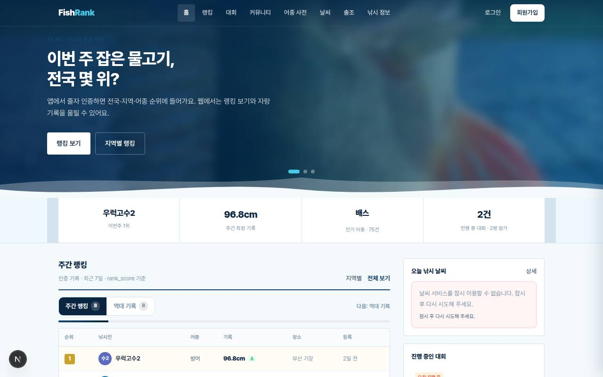
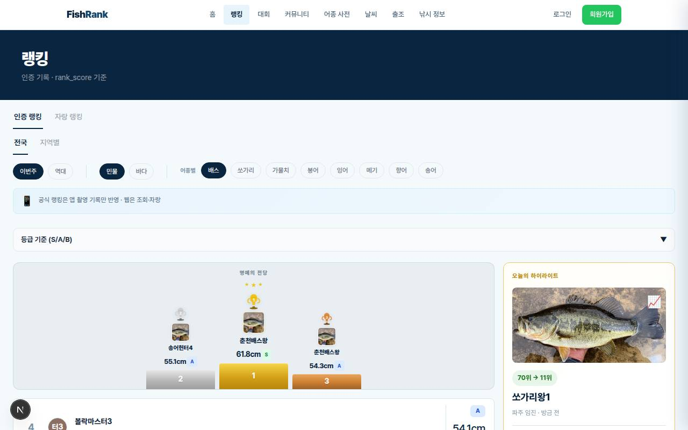
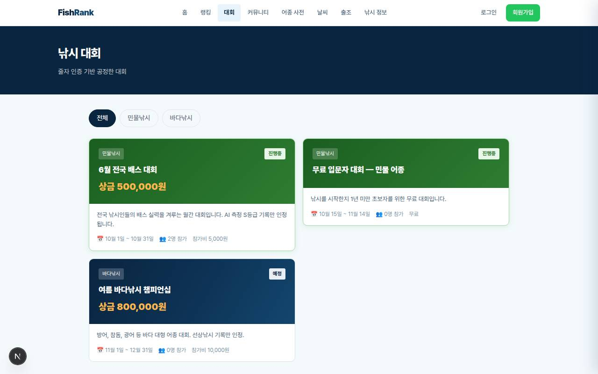
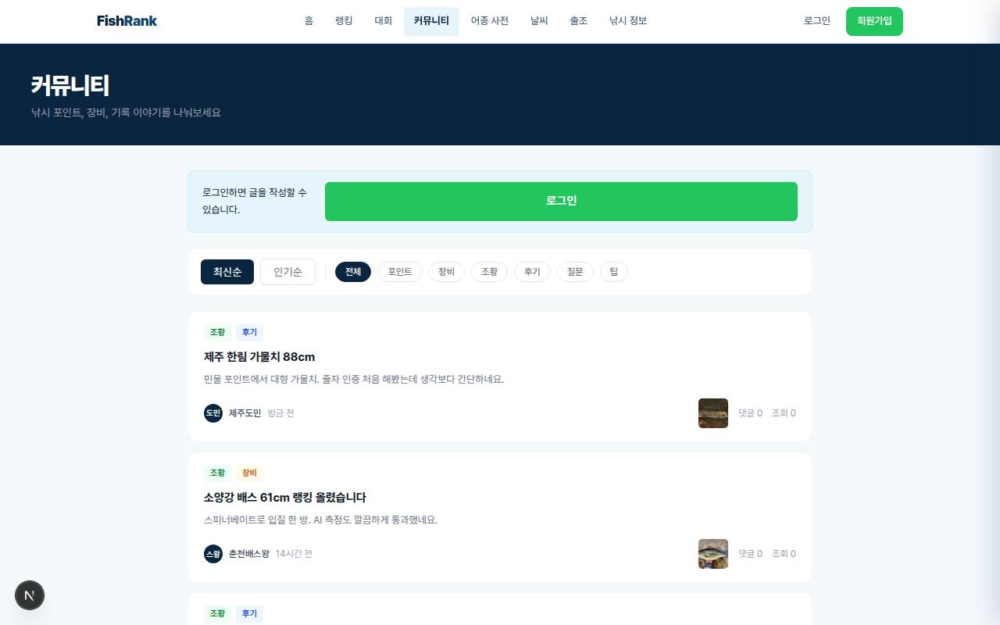
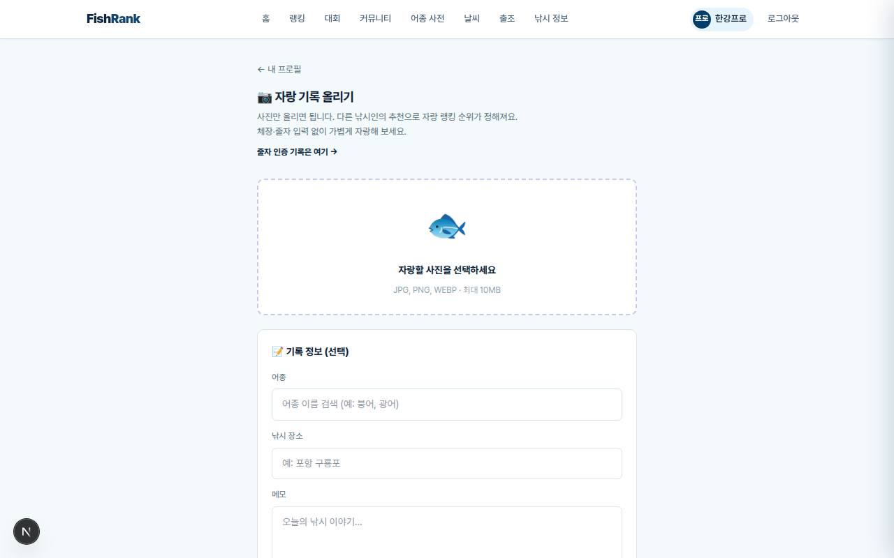
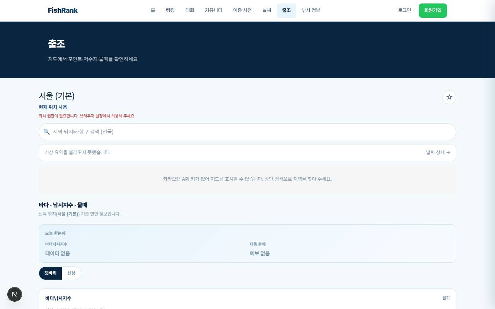
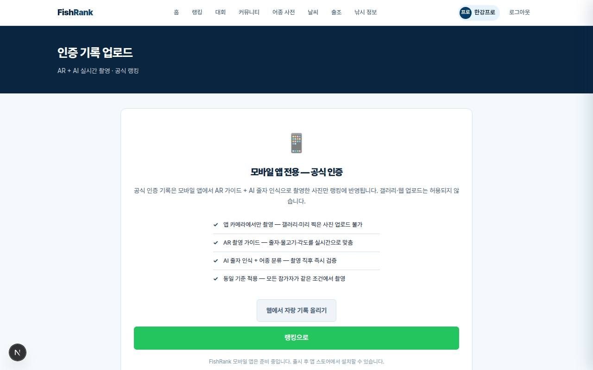
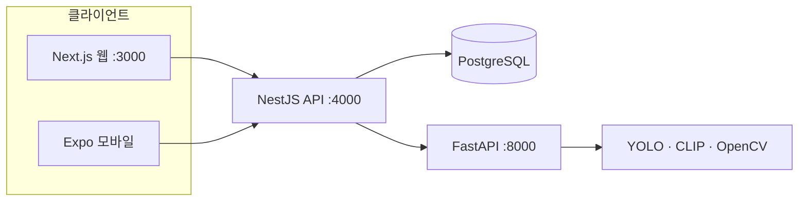

# FishRank

줄자로 물고기 길이를 재고, 그 기록으로 순위·대회·이야기를 나누는 낚시 플랫폼입니다.

웹에서 랭킹과 커뮤니티를 보고, 자랑 기록을 올립니다. 공식 랭킹에 들어가는 줄자 인증 촬영은 모바일 앱의 카메라 가이드로 합니다. 웹의 `/upload`는 그 안내만 보여 줍니다.



짧은 둘러보기: [랭킹, 대회, 커뮤니티, 자랑 기록 폼](docs/assets/demo-browse.mp4)

저장소: [FishRank-TEAM/FishRank](https://github.com/FishRank-TEAM/FishRank)

## 주요 기능

- 이메일 회원가입과 JWT 로그인. 카카오·구글 로그인은 아직 없습니다.
- 주간·어종별·지역별 랭킹. 공식 점수는 `길이(cm) × 어종 희귀도`입니다. 같은 점수면 먼저 올린 기록이 앞섭니다.
- 인증 등급 S/A/B. S와 A는 랭킹에 들어가고, B는 빠집니다.
- 무료 대회 목록, 상세, 참가. 유료 결제와 에스크로는 없습니다.
- 커뮤니티 글, 댓글, 태그, 신고.
- 어종 사전, 낚시 정보(매듭·금지·안전), 날씨, 출조 지도.
- 자랑 기록은 웹에서도 올릴 수 있고, 추천으로 순위가 정해집니다.
- 관리자 화면에서 검수, 신고, 대회, 어종을 다룹니다.

| 등급 | 조건 | 랭킹 |
| --- | --- | --- |
| S | 줄자 인식, 촬영 규칙 통과, 어종 신뢰도 충분 | 반영 |
| A | 줄자와 규칙은 통과, 어종 신뢰도가 낮음 | 반영 |
| B | 줄자를 못 읽거나 규칙 위반 | 제외 |

## 화면

시드 데이터로 띄운 로컬 웹을 찍었습니다. 더 많은 화면과 촬영 조건은 [docs/assets](docs/assets/README.md)에 있습니다.

| 홈 | 주간 랭킹 |
| --- | --- |
|  |  |

| 대회 | 커뮤니티 |
| --- | --- |
|  |  |

| 자랑 기록 | 출조 지도 |
| --- | --- |
|  |  |

공식 인증 촬영 화면은 웹에 없습니다. 웹 `/upload`는 앱 전용 안내입니다.



## 구조



사진은 지금 로컬 `uploads/`에 저장하고, AI 분석은 API가 동기 HTTP로 호출합니다. Redis는 Docker Compose에 있지만 큐로 쓰지 않습니다. S3와 BullMQ는 의존성만 있고 동작에는 쓰이지 않습니다.

| 영역 | 하는 일 |
| --- | --- |
| `fishing/apps/web` | 화면. 랭킹, 대회, 커뮤니티, 사전, 날씨, 출조, 관리자 |
| `fishing/apps/mobile` | 같은 API를 쓰는 Expo 앱. 카메라 인증 업로드 |
| `fishing/apps/api` | 인증, 기록, 랭킹, 업로드, AI 호출 |
| `fishing/ai` | 어종 분류와 줄자 길이 |
| `fishing/packages/shared` | 공통 타입과 상수 |

```
FishRank/
├── docs/assets/          화면 캡처
├── TEAM.md
├── CONTRIBUTING.md
└── fishing/
    ├── apps/web
    ├── apps/api
    ├── apps/mobile
    ├── ai
    ├── packages/shared
    ├── docs/             설계·실행·정책 문서
    └── docker-compose.yml
```

## 기술

| 영역 | 사용 |
| --- | --- |
| 웹 | Next.js 16, React 19, TypeScript, Tailwind CSS 4, TanStack Query, Zustand |
| API | NestJS 11, Prisma, PostgreSQL, JWT |
| 모바일 | Expo 54, expo-router, expo-camera |
| AI | Python 3.12, FastAPI, YOLOv8, CLIP, OpenCV |
| 로컬 | Node.js 20+, npm workspaces, Docker Compose의 PostgreSQL·Redis |

## 시작하기

```bash
git clone https://github.com/FishRank-TEAM/FishRank.git
cd FishRank/fishing
npm install
cp apps/api/.env.example apps/api/.env
cp apps/web/.env.example apps/web/.env
cp ai/.env.example ai/.env
npm run db:up
npm exec --prefix apps/api prisma migrate deploy
npm run db:seed
npm run dev          # 웹 :3000, API :4000
npm run ai           # AI :8000. Python 3.12가 없으면 안내 후 종료
npm run mobile       # Expo. 선택
```

| 주소 | 무엇 |
| --- | --- |
| http://localhost:3000 | 웹 |
| http://localhost:4000/health | API 상태 |
| http://localhost:4000/api/docs | Swagger. 운영(`NODE_ENV=production`)에서는 열리지 않음 |
| http://localhost:8000/health | AI 상태 |

`JWT_SECRET`은 16자 이상이어야 API가 켜집니다. 운영에서는 `AI_SERVER_SECRET`도 기본값이면 기동이 거절됩니다. 명령과 트러블슈팅은 [로컬 개발 가이드](fishing/docs/11-local-development.md)에 있습니다.

## 로드맵

기준은 저장소의 [서비스 개요](fishing/docs/00-service-overview.md)이고, 지금 코드와 맞게 고친 상태입니다.

| 단계 | 내용 | 상태 |
| --- | --- | --- |
| MVP | 이메일 로그인, 랭킹, 무료 대회, 커뮤니티, 사전, 날씨, 낚시 정보, 관리자 | 구현됨 |
| 모바일 | Expo 앱과 카메라 인증 업로드 | 구현됨. 스토어 출시는 아직 |
| AI | 분류와 줄자 측정 연동 | 동작. 정확도 개선 중 |
| 다음 | 소셜 로그인, 팔로우, AR 교차검증, 푸시, 유료 대회, S3, 작업 큐 | 아직 없음 |

## 팀

공개된 GitHub 멤버와 커밋 작성자만 [TEAM.md](TEAM.md)에 적었습니다. 역할과 소개는 비어 있습니다.

## 기여

[CONTRIBUTING.md](CONTRIBUTING.md)에 실행, 커밋, PR 전에 돌릴 명령을 적었습니다. 버그와 기능 제안은 이슈 템플릿을 쓰면 됩니다.

## 문서

| 문서 | 내용 |
| --- | --- |
| [문서 인덱스](fishing/docs/README.md) | 설계 문서 목록 |
| [서비스 소개](fishing/docs/10-service-introduction.md) | 무엇을 하는 서비스인지 |
| [API 명세](fishing/docs/03-api-spec.md) | 엔드포인트 |
| [측정·인증](fishing/docs/05-measurement-system.md) | 촬영 규칙과 등급 |
| [AI 서버](fishing/docs/12-ai-server-structure.md) | FastAPI 파이프라인 |

## 라이선스

`LICENSE` 파일은 없습니다. npm 패키지는 `private`이고, API 패키지 라이선스 칸은 `UNLICENSED`입니다. 공개 라이선스를 정하기 전에는 모든 권리를 보유합니다.

（팀에서 작성: 공개할 라이선스가 있으면 `LICENSE` 파일을 추가）
